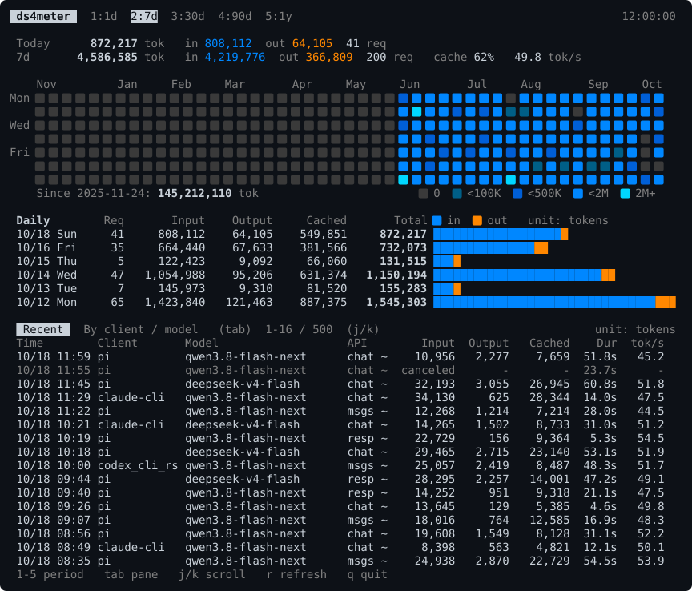

# ds4meter

Records ds4-server token usage and shows it in the terminal.



```sh
python3 path/to/ds4meter/serve.py ./ds4-server --port 8001
python3 path/to/ds4meter/tui.py
```

Other OpenAI/Anthropic-compatible servers that take `--host`/`--port` work the
same way. For example, to meter `sushi serve` on the port its clients already use:

```sh
python3 path/to/ds4meter/serve.py sushi serve --host 0.0.0.0 --port 12345
```

The proxy takes the given port and starts the server on 127.0.0.1 at that port
plus 10000. Always pass `--port`: without it the proxy listens on 8000.
Requests sent straight to the server, bypassing the proxy, are not recorded.
